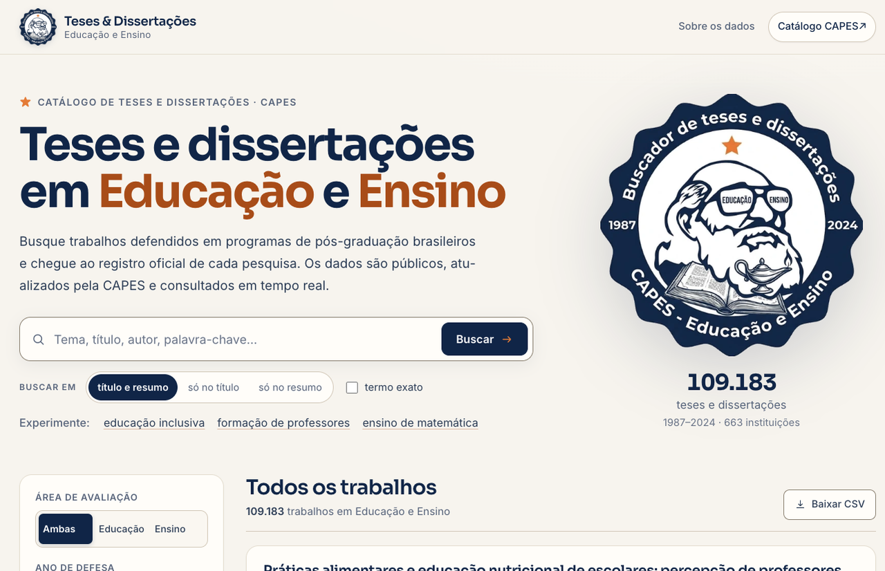
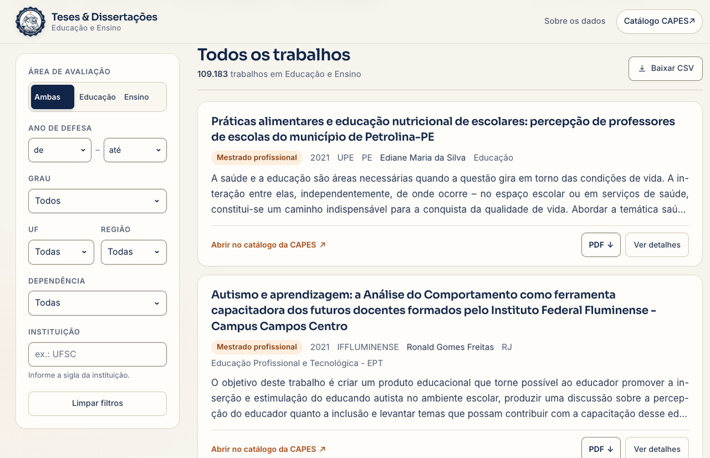
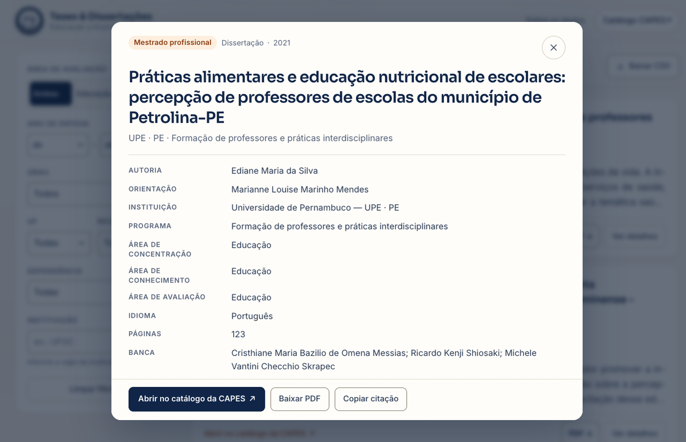
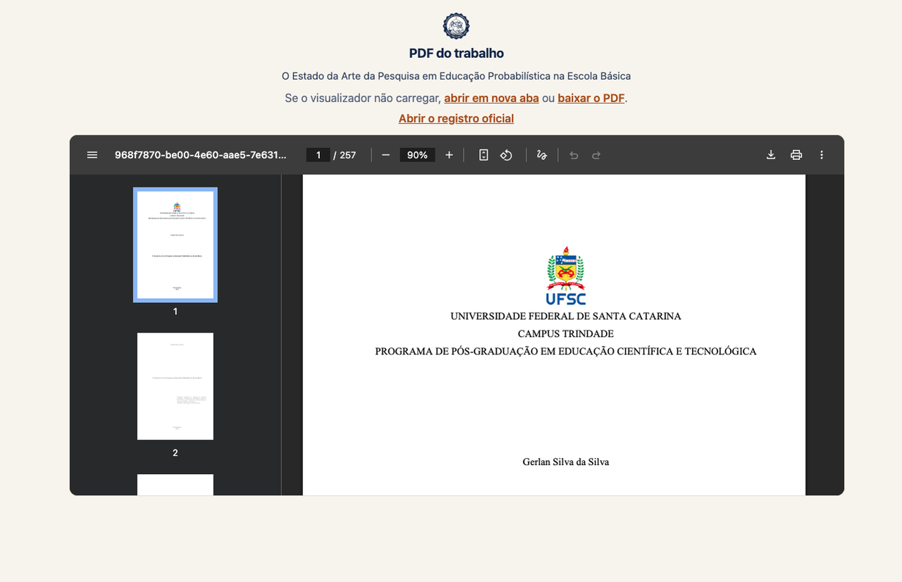
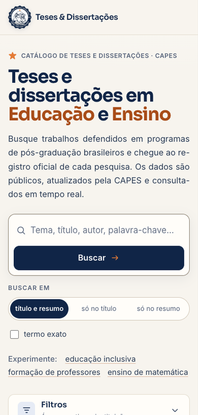

# Teses e Dissertações — Educação e Ensino

Buscador das teses e dissertações brasileiras das áreas de avaliação **Educação** e **Ensino**,
com os dados do Catálogo de Teses e Dissertações da CAPES.

**Repositório:** <https://github.com/gerlansilva/capes_eduensino>

Projeto independente de **Gerlan Silva da Silva** ([@gerlansilva](https://github.com/gerlansilva)),
doutorando em Educação no **Programa de Pós-Graduação em Educação (PPGE)** da
**Universidade Federal de São Carlos (UFSCar)**. Não é um projeto oficial da CAPES nem da UFSCar.

**Site publicado:** <https://capes-eduensino.gerlanmatfis.workers.dev>

A busca, os filtros e os cartões são **estáticos** (HTML + CSS + JavaScript, sem build). A consulta
é feita em tempo real na API pública do Observatório da Pós-Graduação da CAPES, que libera CORS.
O único componente com servidor é o **PDF** (`server.py`), porque o anexo fica atrás de um formulário
da Sucupira — sem ele o site continua funcionando, apenas sem o botão de PDF.


## O que ele faz

- Busca textual por tema, título, autor ou palavra-chave, com opção de restringir
  a **título**, a **resumo** ou a **título e resumo**, e de exigir **termo exato**.
- Filtra por **área de avaliação** (Educação, Ensino ou as duas), **ano**, **grau**
  (mestrado, doutorado, mestrado/doutorado profissional), **UF**, **região**,
  **dependência administrativa** (federal, estadual, municipal, privada) e **instituição** (sigla).
- Mostra cada trabalho no formato do print: título, selo de grau, ano, sigla da IES, UF, autoria,
  área de concentração e as três primeiras linhas do resumo.
- **Link para o registro oficial** em cada cartão (título e botão “Abrir no catálogo da CAPES”).
- **Botão “PDF”** que resolve o anexo do trabalho no registro antigo da CAPES e entrega o arquivo
  (quando o servidor local `server.py` está rodando).
- Diálogo de detalhes com resumo completo, orientação, banca, programa, palavras-chave e
  citação pronta para copiar.
- Exportação dos resultados em CSV (até 300 linhas).
- Estado compartilhável na URL (`?q=...&escopo=titulo&exato=1&area=...&de=...&ate=...&tipo=...&ies=...&uf=...&regiao=...&dep=...&pagina=...`).
- Layout responsivo e navegação por teclado.

## Capturas

### Tela inicial


### Resultados, filtros e botão de PDF


### Detalhes do trabalho


### PDF no visualizador embutido


### Celular


## Identidade visual

- **Selo**: o logo do Buscador de Teses e Dissertações (Darwin, livro e lamparina),
  em `assets/logo-512.webp` com fallback PNG e fundo transparente. Aparece no cabeçalho,
  em tamanho grande no hero e no rodapé.
- **Paleta**: azul-marinho `#102448` (marca e ações), laranja `#e57c2b` (acento e estrela),
  papel quente `#f7f4ed` e superfícies `#fffdf9`. O verde da primeira versão foi removido.
- **Tipografia**: **Sora** para display, títulos e números; **Inter** para o corpo do texto.
  Não há fontes serifadas.
- **Layout**: contêiner de 1240 px, hero em duas colunas (texto e busca à esquerda; selo grande
  e números do acervo à direita, sem cartão de fundo) e resultados em grid com barra de filtros
  fixa (sticky) à esquerda. No celular, o selo grande do hero é omitido para a busca ganhar a
  dobra, e os filtros viram um painel recolhível.
- **Leitura**: parágrafos, resumos dos cartões, resumo do diálogo e textos do rodapé são
  justificados, com hifenização automática em português.

## Como rodar

A forma recomendada é usar o servidor incluído, que serve o site **e** resolve o PDF:

```bash
cd capes-educacao-ensino
python3 server.py
```

Depois acesse <http://localhost:8765>.

O `server.py` usa apenas a biblioteca padrão do Python. Sem ele, o site continua funcionando
(abra `index.html` ou use `python3 -m http.server 8765`), mas o botão **PDF** não aparece,
porque a resolução do anexo depende do servidor.

## PDF dos trabalhos

A API nova do Observatório não expõe o texto completo. O PDF é um anexo da página antiga da
Sucupira, cujo download é um POST JSF com sessão. O `server.py` faz esse caminho:

1. localiza o registro antigo pelo título no catálogo legado da CAPES;
2. abre a página antiga e envia o formulário de download do anexo;
3. entrega o PDF ao navegador com o nome original;
4. se não houver PDF/autorização, redireciona para a página antiga (com o anexo) ou para o
   registro novo.

O PDF é exibido em um **visualizador embutido** na própria página, com links para abrir em nova
aba e para baixar com o nome original. Se o navegador não tiver visualizador de PDF, os links
continuam funcionando. O primeiro acesso a cada trabalho pode demorar (a CAPES às vezes leva mais
de um minuto); depois o arquivo fica em cache de memória no servidor e os próximos acessos são
imediatos.

O PDF é de responsabilidade da CAPES e dos programas; vale a legislação de direito autoral.

## Como publicar

### Cloudflare (site publicado)

O site está no ar em **<https://capes-eduensino.gerlanmatfis.workers.dev>** — Cloudflare
Workers com assets estáticos (o Pages novo é integrado ao Workers).

Para republicar:

```bash
# com PDF servido por um túnel ou pelo Render
CAPES_PDF_API='https://seu-tunel-ou-servico' ./scripts/deploy-cloudflare.sh

# só o site estático (sem botão de PDF)
./scripts/deploy-cloudflare.sh
```

O script monta um diretório temporário apenas com o site, injeta a URL do PDF em
`assets/config.js` e roda `wrangler deploy` no projeto `capes-eduensino`.

A publicação atual usa um **Cloudflare Tunnel temporário** para o PDF: o site no Workers é
permanente, mas o PDF depende do `server.py` e do túnel estarem no ar. Se o túnel reiniciar,
rode o script com a nova URL. Para PDF permanente, use o Render abaixo ou um túnel nomeado.

### PDF no Render (recomendado com Cloudflare Pages)

1. Crie um **Web Service** no Render apontando para este repositório.
   O `render.yaml` já traz a configuração: runtime Python, `startCommand: python3 server.py`
   e health check em `/api/health`.
2. Copie a URL do serviço (ex.: `https://capes-eduensino-pdf.onrender.com`).
3. Em `assets/config.js`, preencha:

```js
window.CAPES_PDF_API = 'https://capes-eduensino-pdf.onrender.com';
```

4. Publique o Pages novamente. O site continua no Cloudflare; só o PDF é resolvido no Render.

O `server.py` também serve o site inteiro — a página de espera do PDF usa os assets
(`/assets/...`) do próprio serviço. O plano gratuito do Render hiberna; a primeira consulta
pode demorar para acordar.

### Cloudflare Tunnel (tudo na sua máquina)

Se quiser o site e o PDF no mesmo domínio, sem separar serviços:

```bash
python3 server.py
cloudflared tunnel --url http://localhost:8765
```

Nesse caso deixe `window.CAPES_PDF_API = ''` em `assets/config.js`: o site usa o mesmo domínio
para `/api/health` e `/api/pdf`. A máquina precisa ficar ligada com o servidor e o túnel no ar.

### Outras hospedagens

- **Netlify / GitHub Pages / Vercel**: funcionam para o site estático; para o PDF é preciso o
  `server.py` em outro serviço e a URL em `assets/config.js`.
- **Render/Fly sozinho**: publique o repositório inteiro; o `server.py` serve o site e o PDF
  no mesmo domínio, sem precisar de `CAPES_PDF_API`.

Não há variáveis de ambiente obrigatórias; a URL do PDF é configurada no arquivo
`assets/config.js`.

## Fonte dos dados

| Item | Endereço |
| --- | --- |
| Lista de trabalhos | `https://apigw-proxy.capes.gov.br/observatorio/data/catalogo/producao` |
| Detalhe de um trabalho | `https://apigw-proxy.capes.gov.br/observatorio/data/catalogo/producao/{id}` |
| Facetas e totais | `https://apigw-proxy.capes.gov.br/observatorio/facetas/data/catalogo/producao?totalizar=true` |
| Instituições (UF) | `https://apigw-proxy.capes.gov.br/observatorio/data/online/ies` |
| Registro oficial | `https://sucupira.capes.gov.br/observatorio/detalhamento/teses-e-dissertacoes/{id}` |
| Documentação | <https://apigw-proxy.capes.gov.br/observatorio/documentacao?origem=catalogo&path=producao> |

O filtro de área usa a faceta `nome-area-avaliacao`. Os valores vêm da API; a chave de
`EDUCAÇÃO` é preenchida com espaços à direita (a base antiga grava assim), e por isso o código
lê a chave diretamente da resposta de facetas em vez de montá-la à mão.

### Números da base

- **109.183** trabalhos (72.668 em Educação + 36.515 em Ensino).
- **1987 a 2024**.
- **663** instituições com sigla cadastrada.

## Estrutura

```
index.html              marcação e textos
assets/styles.css       todo o estilo (sem framework)
assets/app.js           consulta, filtros, cartões, diálogo e CSV
assets/ui.js            abre/fecha o painel de filtros conforme o breakpoint
assets/ies.js           cadastro de IES, grupos de UF/região/dependência e programas
assets/config.js        URL do serviço de PDF (Cloudflare Pages + Render/Tunnel)
server.py               servidor local + resolução/download do PDF
tools/build_ies.py      regenera assets/ies.js a partir da API
scripts/deploy-cloudflare.sh  publica o estático no Workers (com PDF opcional)
render.yaml             configuração do Web Service no Render
requirements.txt        sem dependências (biblioteca padrão)
assets/logo-512.webp    selo em WebP (usado na interface)
assets/logo-512.png     fallback do selo
docs/                   capturas de tela usadas neste README
LICENSE                 licença do código (MIT)
```

`ies.js` é um arquivo JavaScript, e não JSON, para que o site funcione também aberto
diretamente por `file://` (navegadores bloqueiam `fetch` de arquivos locais).

### Regenerar `assets/ies.js`

```bash
cd capes-educacao-ensino
python3 tools/build_ies.py
```

O script baixa o cadastro de instituições e o catálogo de programas da CAPES, mantém apenas
as áreas de Educação e Ensino e grava os grupos de UF, região e dependência (por id interno da
IES) e os ids dos programas profissionais. Ele não tem dependências além da biblioteca padrão.

## Filtros derivados

A API do catálogo não oferece facetas de UF, região, dependência ou grau acadêmico. Por isso:

- **UF, região e dependência** são resolvidas a partir do cadastro de IES e dos programas das
  áreas de Educação/Ensino. O site envia ao catálogo a lista de ids internos dessas instituições
  (`id-ies`), que é curta e exata.
- **Grau** usa o tipo da produção para mestrado/doutorado e, para as modalidades profissionais,
  a lista de ids dos programas profissionais (`id-programa`).
- A lista considera as instituições com programa nas áreas de Educação/Ensino no catálogo atual
  (185 IES). Instituições que encerraram todos os programas podem não aparecer nos filtros.

O filtro de **instituição** também usa o id interno quando a sigla está no cadastro, o que evita
diferenças de grafia entre a sigla da IES e a sigla usada nos registros do catálogo.

## Limitações conhecidas

- **Total exato**: a API devolve `size: -1` quando há busca textual e também quando a consulta
  usa listas de ids (UF, região, dependência, instituição ou grau profissional). Nesses casos a
  interface mostra “Mostrando N trabalhos” e a paginação avança enquanto houver resultados.
  Sem esses filtros, o total é exato.
- **Busca por campo**: a API não tem filtro de título/resumo. Em “só no título” e “só no resumo”
  o site usa a busca do catálogo como fonte de candidatos e confere o termo no campo escolhido,
  no navegador. Por isso esses modos mostram “Mostrar mais” em vez de páginas e podem exibir
  “resultados parciais” se o serviço da CAPES oscilar no meio da varredura.
- **Ordenação**: a API não aplica o parâmetro `sort`. A ordem é a do serviço da CAPES
  (por relevância quando há termo). Para recortes cronológicos, use o filtro de ano.
- **Tamanho da página**: são 15 itens por página. Lotes maiores (>~18) com vários filtros
  combinados fazem o serviço da CAPES responder 500; 15 foi o valor estável nos testes.
- **Resumo**: vem do endpoint de detalhe, uma chamada por cartão (em paralelo e com cache em
  memória). Se um detalhe falhar, o cartão continua com link para o registro oficial.
- **PDF**: depende da página antiga da Sucupira e do servidor local; o primeiro download pode
  ser lento, o anexo só existe quando a divulgação foi autorizada e a visualização embutida
  depende do suporte a PDF do navegador (os links de abrir/baixar cobrem os demais casos).
- **Qualidade dos metadados**: títulos, resumos e nomes são de responsabilidade dos programas.
  Registros antigos vêm em CAIXA ALTA e são convertidos para caixa de frase na exibição.

## Acessibilidade

- Estrutura semântica (`main`, `nav`, `article`, `dialog`), rótulos em todos os campos,
  foco visível e link para pular ao conteúdo.
- Contagem de resultados em região `aria-live`.
- Diálogo nativo (`<dialog>`), fecha com `Esc` e devolve o foco ao elemento de origem.
- Respeita `prefers-reduced-motion`.

## Licença

O **código** deste projeto está sob a licença MIT (veja `LICENSE`).
Os **dados** do catálogo são publicados pela CAPES em <https://dadosabertos.capes.gov.br/>
(licença CC-BY). Os PDFs pertencem aos autores e aos programas de pós-graduação; o site apenas
encaminha o anexo disponibilizado pela própria CAPES.

## Aviso

Este é um projeto independente de **Gerlan Silva da Silva**
([@gerlansilva](https://github.com/gerlansilva)), doutorando em Educação no Programa de
Pós-Graduação em Educação (PPGE) da Universidade Federal de São Carlos (UFSCar).
Não possui vínculo institucional com a CAPES nem com a UFSCar.
O uso das informações está sujeito à Lei nº 9.610/1998 (direitos autorais).
